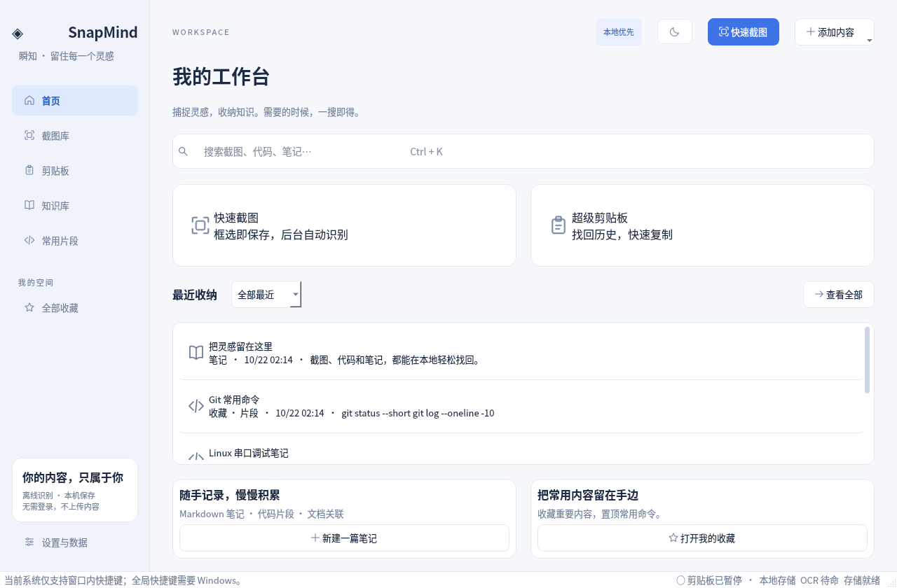

# SnapMind · 瞬知

本地截图、离线 OCR、超级剪贴板与个人知识收纳的原生桌面应用。中文优先，默认浅色，支持深色；无登录、无 API Key、不上传用户内容。

**Windows x64 便携版已构建成功，Windows 运行器上的自动化测试、打包后 EXE 启动和离线 OCR 检查通过。真实桌面的全局快捷键、多显示器和混合 DPI 仍需人工验收。** 详情见 [测试报告](docs/TEST_REPORT.md)。

[下载 Windows 便携包（GitHub 登录后）](https://github.com/xuan511/learngit/actions/runs/39713524352/artifacts/12398510897) · [查看成功的 Windows 构建](https://github.com/xuan511/learngit/actions/runs/39713524352) · [直接下载源码 ZIP](https://github.com/xuan511/learngit/raw/refs/heads/snapmind-desktop/SnapMind/dist/SnapMind-0.1.0-source.zip)



## 三次操作内完成核心任务

- 截图识别：`Ctrl+Alt+A` → 拖动并松开选区。自动保存并后台 OCR，无需再点“识别”。首次模型加载也在后台。预览窗口可关闭，结果保留在截图库。
- 历史检索：`Ctrl+Alt+F`（窗口内也可 `Ctrl+K`）→ 输入 `0x09F0` 或中文关键词 → 选择结果。
- 历史复用：`Ctrl+Alt+V` → 输入关键词 → `Enter` 复制。之后由用户自己切换到目标窗口粘贴。

以上全局快捷键用于 Windows，可在设置中自定义并检查注册冲突；不占用系统的 `Win+Shift+S`。Linux 验证环境只启用窗口内快捷键。

## 已实现

- 每显示器矩形选区、Esc 取消、自动保存 / 自动 OCR，预览、PNG / JPG 导出、复制图片、收藏及转笔记。
- 矩形、箭头、画笔、文字、实际像素马赛克、撤销 / 重做；标注另存副本保留原图。
- 内置中文 / 英文离线 OCR 模型，惰性加载，串行后台队列，原始 OCR 和手工修正文分别保存；历史图片按页批量 OCR。
- 剪贴板文本、代码、HTML 与纯文本、图片、本地文件列表、URL 捕获，持久化去重、快捷搜索复制、置顶、收藏、删除、类型筛选。
- 暂停监控、Windows 前台应用黑名单、条数 / 天数 / 单条大小限制、关闭图片历史、私密标记。
- 统一 SQLite FTS5 + 中文 / 短字符串回退搜索，标签、日期、类型、收藏筛选，英文近似匹配与分页。
- Markdown 笔记和片段自动保存、关联截图 / PDF / 其他记录、页码、PDF 可选文本提取、外部文件失效提示及重新定位。
- 系统托盘入口、关闭 / 最小化到托盘、重复启动锁、深浅主题；托盘不可用时正常退出。
- 一致性 ZIP 备份、附件和 JSON 导出、校验恢复、保留恢复前副本、引用附件删除保护。

## Windows 用户运行

1. 登录 GitHub，打开上方 Windows 下载链接；也可进入成功构建页面，下滑到 **Artifacts**，点击 **SnapMind-Windows-x64**（约 132 MB）。
2. 解压下载的外层 Artifact ZIP，再解压其中的 `SnapMind-0.1.0-Windows-x64.zip`。
3. 打开 `SnapMind` 文件夹，双击 `SnapMind.exe`。最终用户无需安装 Python。

这些文件由云端和 GitHub 运行器生成，不会自动出现在你的本地电脑；点击下载后才会保存到浏览器的下载目录。`/workspace/...` 是云端路径。

请将整个文件夹放在可写目录，不要放在 `Program Files`。不能只复制 EXE；`_internal/` 包含 Qt、OCR 模型和运行库。数据默认在 EXE 同级 `data/`，配置在 `config/`。如需其他位置，可以使用 `SnapMind.exe --data-dir "D:\个人资料\瞬知"`。

首次进入界面，底部说明关闭按钮会隐藏到托盘；托盘菜单“完全退出”才结束程序。可在“设置与数据”改变关闭行为。截图识别和历史搜索均不需要网络。

## 开发与构建

要求 Python 3.12 x64；Windows 10 / 11 为目标平台。每个云任务已隔离，直接使用现有 checkout，无需 Git worktree。

```powershell
cd SnapMind
py -3.12 -m venv .venv
.venv\Scripts\python -m pip install -r requirements-dev.txt
.venv\Scripts\python run.py
```

Windows 测试、校验模型、打包和 EXE 启动检查：

```powershell
powershell -File tools\build-windows.ps1
```

也可手工运行 `.venv\Scripts\python -m tools.build --target windows`。Windows 构建输出 `dist/SnapMind/` 和 ZIP / SHA-256；构建工具按目标操作系统运行，不支持在 Linux 交叉生成 Windows EXE。

仓库包含 `.github/workflows/snapmind-windows.yml`，支持手动运行或相关文件变更时构建。项目已上传到 `snapmind-desktop` 分支，Windows 成功构建记录见上方链接；该次构建的提交为 `5768368def0fb643b6b3fbeb2eb46655d89ffb84`。

Linux 验证：

```bash
python3.12 -m venv .venv
.venv/bin/python -m pip install -r requirements-dev.txt
QT_QPA_PLATFORM=offscreen .venv/bin/python -m pytest -q
QT_QPA_PLATFORM=offscreen .venv/bin/python run.py --data-dir /tmp/snapmind-check --smoke
.venv/bin/python -m tools.verify_models
# 有桌面会话时正常运行：
.venv/bin/python run.py
# 本机原生验证包，仅为 Linux，不是 Windows EXE：
.venv/bin/python -m tools.build --target native
```

`--smoke` 验证真实窗口、初始化与事件循环后退出，不进行截图。`python -m tools.snapshot` 在临时数据目录生成实机 Qt 界面截图；其中的示例内容仅用于视觉测试，不写入用户数据。`python -m tools.benchmark` 在临时目录测量本机启动、内存、OCR 和 10000 条历史检索。

## 数据与隐私

备份入口在“设置与数据”。ZIP 中有 SQLite 数据库、托管附件以及 `export/records.json`，可独立查看和迁移；配置文件单独保存在 `config/settings.json`。外部文件链接不会复制其源文件。恢复会替换当前数据，并保留 `data-before-restore-*` 副本；确认恢复内容后可自行删除旧副本。

“私密”隐藏列表标题和摘要，不是加密。数据库、附件及备份均为本机明文，请使用操作系统账户权限或磁盘加密保护。黑名单基于复制时的前台应用，不能保证发现所有密码或机密。默认不联网；用户主动点网页链接或“打开附件”时会交给系统默认应用。

参考 [使用说明](docs/USER_GUIDE.md)、[架构](docs/ARCHITECTURE.md)、[测试报告](docs/TEST_REPORT.md) 和 [第三方许可](THIRD_PARTY_NOTICES.md)。扫描版 PDF 逐页 OCR 是后续功能；目前可截图页面识别，PDF 可选文本可以直接导入。
